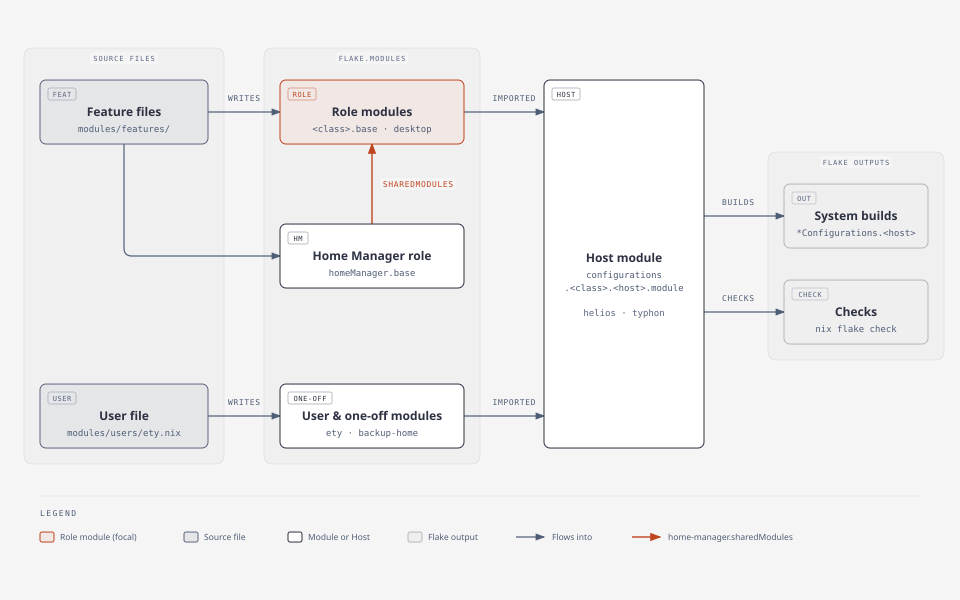

# Architecture

How the pieces of this flake fit together. Terms (Feature, Class, Host, User, Role) are defined
in [GLOSSARY.md](GLOSSARY.md); the reasons behind the shape are in [docs/adr/](docs/adr/),
mainly [0001](docs/adr/0001-composition-by-import.md). This file says _where_ things are and
_how_ they connect, not _why_.

## How a Feature reaches a Host

<picture>
  <source media="(prefers-color-scheme: dark)" srcset="docs/architecture/composition-dark.svg">
  
</picture>

1. `flake.nix` hands every `.nix` file under `modules/` to import-tree, which imports each as a
   flake-parts module. Paths containing `/_` are skipped; those files are imported by hand
   from a sibling (`_backup-home.nix`, `_disko.nix`, `_hardware.nix`).
2. A Feature file writes its config for each Class it touches into a Role module:
   `flake.modules.darwin.base`, `flake.modules.nixos.base`, `flake.modules.nixos.desktop`,
   `flake.modules.homeManager.base`. These are `deferredModule` options, so many files merge
   into one module. Features have no `enable` flag.
3. The User file does the same under the User's own name (`darwin.ety`, `nixos.ety`,
   `homeManager.ety`). A Feature that only some Hosts take gets its own name too
   (`darwin.backup-home`).
4. `home-manager.nix` puts `homeManager.base` into `home-manager.sharedModules` of both system
   `base` Roles. A Host never imports a Home Manager module itself: taking `base` gives every
   User on the Host the Home Manager half too.
5. A Host file declares `configurations.<class>.<host>.module` and imports the Roles and User
   it wants from `config.flake.modules`.
6. [`modules/flake/configurations.nix`](modules/flake/configurations.nix) turns each entry into
   `darwinConfigurations.<host>` or `nixosConfigurations.<host>`, sets the hostname, and adds the
   system's toplevel to `checks`, so `nix flake check` builds every Host.

## Codemap

```
flake.nix                 inputs; outputs = import-tree ./modules
modules/
  flake/                  the top-level plumbing, no Features
    configurations.nix    configurations.<class>.<host>.module → *Configurations + checks
    flake-parts.nix       systems; enables flake.modules and treefmt
    pkgs.nix              perSystem pkgs: nixpkgs (nixpkgs-darwin on macOS) + `unstable` overlay
    formatter.nix         nix fmt (nixfmt, prettier, shfmt, deadnix, statix)
    templates.nix         nix flake init -t ~/nix-config#<name>
  features/               one file per Feature; writes into Role modules
  users/ety.nix           the User: darwin.ety, nixos.ety, homeManager.ety
  hosts/<host>/           one directory per Host; default.nix is the Host module
templates/                project templates (python, cpp); outside modules/ so never imported
secrets/<host>.yaml       sops-encrypted, one file per Host (docs/adr/0005)
devices/                  scripts for devices Nix does not manage (zephyr: Termux)
docs/adr/                 decisions;  docs/research/  evidence behind them
```

## Roles and Hosts today

| Role module        | Features                                                                                    |
| ------------------ | ------------------------------------------------------------------------------------------- |
| `darwin.base`      | darwin-settings, home-manager, homebrew, mac-apps, nix-daemon, nixpkgs, sops, touch-id, zsh |
| `nixos.base`       | home-manager, nix-daemon, nix-ld, nixpkgs, sops, ssh, tailscale, zsh                        |
| `nixos.desktop`    | audio, bluetooth, firefox, network-manager, plasma                                          |
| `homeManager.base` | direnv, fzf, gh, git, nix-index, nix-tools, ripgrep, sops, ssh, starship, zsh               |
| one-off            | `darwin.backup-home` (daily mirror of `~` to the NAS; declares its own sops secrets)        |

| Host     | Class                  | Imports                                                      | State             |
| -------- | ---------------------- | ------------------------------------------------------------ | ----------------- |
| `helios` | darwin, aarch64-darwin | `base`, `ety`, `backup-home`                                 | live install      |
| `typhon` | nixos, x86_64-linux    | `base`, `desktop`, `ety`, plus disko and its hardware config | not installed yet |

Only `base` has a Home Manager half so far. A darwin-only Home Manager setting goes into
`darwin.base` as its own `home-manager.sharedModules` entry (see `mac-apps.nix`).

## Where a change goes

- **New Feature for every Host:** a new file in `modules/features/` writing into the `base` of
  each Class it touches. `git add` it: the flake cannot see untracked files.
- **Feature for some Hosts only:** put it in a Role those Hosts take (`nixos.desktop`), or give it
  its own name and import it from the Host if it is genuinely one-off. Never turn it off with
  `mkForce false` (docs/adr/0001).
- **Per-User settings:** `modules/users/ety.nix`. GUI apps on macOS are Homebrew casks there,
  CLI tools come from nixpkgs (docs/adr/0003).
- **Per-machine facts** (platform, stateVersion, sops key path, disks): the Host module.
- **A newer package:** `pkgs.unstable.<name>`; every Host gets the overlay from `pkgs.nix`
  through `nixpkgs.nix`.
- **A secret:** declared by the module that reads it, in that Host's `secrets/<host>.yaml`
  (docs/adr/0005).

## Invariants

- Importing a module enables it; there is no feature registry and no `enable` option.
- Each `flake.modules` value is imported along exactly one path. They carry no `key`, so the
  module system does not deduplicate them, and a second import applies its definitions twice.
- `configurations.<class>.<host>.module` holds Host modules only, never Feature or User fields.
- Other modules are reached through `config.flake.modules` by closure; no `specialArgs`.
- `home-manager.sharedModules` applies to every User on a Host. That is fine with one User; a
  second User sharing a Host needs a rethink.
- `helios` keeps `system.stateVersion = 6` and `home.stateVersion = "24.11"`.
